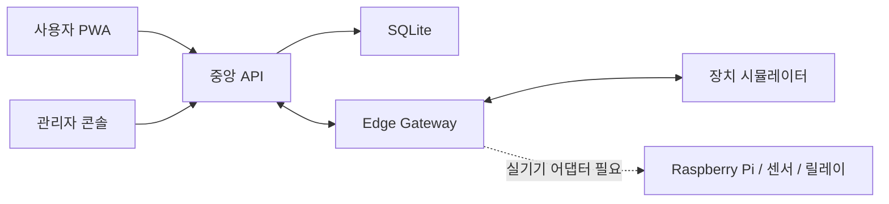

# SmartFarmOS

SmartFarmOS는 농장 상태 확인, 알람 대응, 관수 제어, 장치 연결을 하나의
흐름으로 묶는 스마트팜 운영 플랫폼입니다. TypeScript 모노레포 안에 사용자
PWA, 관리자 콘솔, 중앙 API, Edge Gateway, 장치 시뮬레이터를 함께 구성했습니다.

[빠른 시작](#빠른-시작) · [문서](docs/README.md) · [기여](CONTRIBUTING.md) ·
[보안](SECURITY.md) · [지원](SUPPORT.md)

현재 버전은 실제 장비 없이도 두 개 재배 구역의 전체 흐름을 로컬에서 재현할
수 있는 **프리릴리스**입니다.

> [!IMPORTANT]
> SmartFarmOS 저장소의 프로젝트 소스는 Apache License 2.0으로 공개할
> 준비를 마쳤습니다. 외부 의존성·자료는 각 항목의 원래 라이선스를 따르며,
> 기존 교육 프로젝트의 계약 제한과 제3자 자산은 공개 전 별도로 확인합니다.

> [!WARNING]
> 현재 관수와 정지는 시뮬레이터 기반 소프트웨어 동작입니다. 물리 비상정지,
> 하드웨어 인터록, 실제 펌프 안전성 또는 작물 보호를 입증하지 않습니다.

## 한눈에 보기

| 항목 | 현재 상태 |
| --- | --- |
| 로컬 실행 | 가능 — API, PWA, 관리자 콘솔, Edge, 시뮬레이터 통합 실행 |
| 자동 검증 | `npm run verify` — 빌드·타입·테스트, Chrome/Chromium 사용 가능 시 브라우저 스모크 |
| 웹 기능 | 두 구역 모니터링, 알람, 작물 관리, 관수 제어, 감사 이력 |
| Raspberry Pi 연결 | 등록·자격 증명 저장·서비스 실행 경로 구현, 실기기 수동 검증 필요 |
| 실제 센서·릴레이 | 미구현 — GPIO, MQTT, 시리얼 어댑터 필요 |
| 운영 환경 | 미지원 — 운영용 인증·데이터 운영·장치 관리 보강 필요 |
| 공개 오픈소스 릴리스 | 준비 중 — Apache-2.0 적용, 계약·제3자 자산, 자격 증명, privacy, 공개 Git 이력 확인 필요 |

## 빠른 시작

### 준비 사항

- Node.js 24 (`.nvmrc` 포함)
- npm 10 이상
- 전체 브라우저 검증을 위한 Chrome 또는 Chromium

저장소 루트에서 다음 세 명령을 실행합니다.

```bash
nvm use
npm ci
npm run demo:local
```

실행 후 브라우저에서 접속합니다.

| 화면 | 개발 모드 | 빌드 미리보기 |
| --- | --- | --- |
| 사용자 PWA | `http://127.0.0.1:5173` | `http://127.0.0.1:4173` |
| 관리자 콘솔 | `http://127.0.0.1:5174` | `http://127.0.0.1:4174` |

빌드 결과를 미리 보려면 다음 명령을 사용합니다.

```bash
npm run demo:local:preview
```

종료할 때는 실행한 터미널에서 `Ctrl+C`를 누릅니다. 로컬 데모는 매번 임의의
인증 키를 만들고 `127.0.0.1`에만 바인딩합니다.

포트 변경, 깨끗한 데이터베이스, 브라우저 검증 설정은
[시작 가이드](docs/getting-started.md)에서 확인할 수 있습니다.

## 데모에서 확인할 수 있는 흐름

1. 사용자 PWA에서 두 재배 구역의 온도, 습도, 조도, 수위를 비교합니다.
2. 저수위 알람의 발생 원인과 구역을 확인하고 알람을 확인 처리합니다.
3. 대상 구역과 안전 고지를 검토한 뒤 5초 관수 프리셋을 실행합니다.
4. 장치가 최종 `off` 상태를 반환한 후 완료 결과와 감사 이력을 확인합니다.
5. 관리자 콘솔에서 Raspberry Pi용 일회성 등록 토큰을 발급하거나 취소하고,
   발급된 Edge 자격 증명의 상태를 조회·폐기합니다.

이 흐름은 브라우저, API, Edge 계약과 복구 동작을 검증하기 위한 것입니다.
시뮬레이터 결과를 실제 릴레이 또는 펌프 시험 결과로 사용하면 안 됩니다.

## 구현 범위

### 사용자 PWA

- 농장과 장치 탐색
- 작물 등록·수정·삭제와 재배 구역 연결
- 두 구역의 최신 환경 값, 24개 이력, 신선도와 오프라인 상태 표시
- 저수위 알람 발생·확인·해제 이력
- 수동 펌프 명령과 검토된 관수 프리셋
- 최근 제어 결과와 감사 기록
- 반응형 화면, 설치 가능한 PWA, 오프라인 앱 셸
- 고정 테스트 데이터를 사용하는 날씨·위치 화면

### 중앙 API와 Edge Gateway

- 런타임 스키마로 검증되는 HTTP 계약
- 농장·장치 범위가 고정된 Edge 인증
- SQLite 기반 텔레메트리, 명령, 알람, 감사 이력 저장
- 명령 완료 결과를 먼저 Edge SQLite에 기록한 뒤 중앙 API로 전달
- 업로드 실패 또는 Edge 재시작 후 장치를 다시 실행하지 않고 동일 ACK 재전송
- 실행 중 상태가 불명확하면 자동 재실행하지 않는 복구 경계
- 일반 명령과 분리된 소프트웨어 정지 우선 경로

### 관리자와 장치 등록

- 10분 유효·1회 사용 Edge 등록 토큰
- 브라우저에 비밀값을 저장하지 않는 일회성 자격 증명 전달
- 등록 대기 취소와 활성 자격 증명 폐기
- Raspberry Pi TTY에서만 토큰을 입력받는 `smartfarm-edge enroll`
- 권한 `0600`의 로컬 자격 증명 파일과 비밀값을 숨긴 상태 조회
- Linux 로컬 계정 비밀번호를 브라우저나 중앙 API에 전달하지 않는 변경 명령

## 아키텍처

브라우저는 데이터베이스나 Edge 자격 증명, 장치에 직접 접근하지 않습니다.



```text
apps/pwa/               사용자용 설치형 PWA
apps/admin/             장치 등록·자격 증명 관리자 콘솔
services/api/           브라우저와 Edge가 사용하는 중앙 API
services/edge/          장치 경계와 명령/ACK 복구 런타임
packages/contracts/     공용 도메인·HTTP 스키마
packages/module-sdk/    검토된 모듈 매니페스트와 정적 레지스트리
tools/device-simulator/ 하드웨어 독립 장치 시뮬레이터
tools/local-demo/       루프백 전용 통합 데모
deploy/cloud-pilot/     대회·파일럿용 배포 참고 구성
deploy/edge/            Raspberry Pi 설정과 systemd 예시
docs/                   아키텍처, 계약, 결정 기록과 검증 경계
scripts/verify.sh       저장소 전체 검증 진입점
```

## Raspberry Pi 연결 상태

현재 구현된 연결 순서는 다음과 같습니다.

```text
관리자 콘솔에서 일회성 토큰 발급
  -> Pi의 숨김 TTY 입력으로 토큰 교환
  -> farmId/deviceId가 일치하는 Edge 자격 증명 저장
  -> smartfarm-edge 서비스가 중앙 API의 명령을 폴링
```

Pi에서 등록, 자격 증명 상태 확인, 데몬 시작까지 실행할 수 있습니다. 다만 실제
GPIO, 센서, 릴레이, MQTT, 물리 비상정지는 아직 연결되지 않았습니다. 현 단계의
Pi 테스트는 **등록·파일 권한·프로세스 실행 확인**으로 한정해야 합니다.

## 검증

전체 검증은 한 명령으로 실행합니다.

```bash
npm run verify
```

로컬에 Chrome/Chromium이 없으면 브라우저 경로는 건너뛸니다. CI에서는
`SMARTFARM_REQUIRE_BROWSER=1`로 필수화합니다. 로컬에서도 같은 수준으로 검증하려면
다음과 같이 실행합니다.

```bash
SMARTFARM_REQUIRE_BROWSER=1 npm run verify
```

이 명령은 모든 워크스페이스의 빌드, 타입 검사, 테스트와 함께 다음 경로를
검증합니다.

```text
시뮬레이터 -> Edge Gateway -> 중앙 API -> SQLite -> PWA
사용자 명령 -> API -> Edge -> 시뮬레이터 -> ACK -> 감사 이력
ACK 업로드 실패 -> Edge 재시작 -> 동일 ACK 복구 전송
중앙 API 재시작 -> 텔레메트리와 완료 명령 복구
저수위 발생 -> 알람 -> 확인 -> 감사 -> 자동 해제
다른 장치의 Edge 자격 증명 -> 데이터 변경 전 403 거부
```

개발 중에는 필요한 검사만 따로 실행할 수 있습니다.

```bash
npm run build
npm run typecheck
npm run test
npm run smoke:pwa:browser
```

## 공개 전 필수 게이트

자동 검증 통과는 소스 공개 승인이 아닙니다. 다음 항목은 권리자와
프로젝트 소유자가 실제 증거로 닫아야 합니다.

- 단독 작성자 확인과 별개로 기존 교육 프로젝트의 계약 제한과 제3자 자산 권리 확인
- Apache-2.0 적용 범위와 외부 의존성·자료의 개별 라이선스 유지 확인
- 레거시 자격 증명 폐기·회전 확인과 최종 공개 범위 privacy 검사
- 공개할 변경분을 식별 가능한 커밋으로 확정한 뒤 새 clone에서 `npm ci` 및
  `npm run verify` 재현

현재 판정과 소유자 확인 항목은 [공개·제출 체크리스트](docs/submission/release-checklist.md),
[출처 원장](docs/provenance.md), [자격 증명 회전 체크리스트](docs/credential-rotation.md)에서
관리합니다.

## 제품 로드맵

- 실제 Raspberry Pi에서 등록·자격 증명·systemd 서비스 수동 시험
- GPIO, 센서, 릴레이 또는 MQTT용 실기기 어댑터 구현과 별도 안전 검증
- 네트워크 단절 시 텔레메트리 버퍼링과 실행 중 장치 상태 재조정
- 여러 Edge Gateway가 연결될 때의 장치 소유권과 명령 임대 정책
- 운영용 사용자 인증, 권한 관리, 장치 인벤토리와 데이터 운영 구성
- 농업 종사자 또는 도메인 대리인 3~5명의 사용성 시험

## 문서

- [시작 가이드](docs/getting-started.md)
- [전체 문서 색인](docs/README.md)
- [아키텍처](docs/architecture.md)
- [HTTP V1 계약](docs/contracts/http-v1.md)
- [기능 구현 현황과 로드맵](docs/feature-parity.md)
- [사용성 현장 시험 절차](docs/usability/field-test-protocol.md)
- [클라우드 파일럿 경계](docs/deployment/cloud-pilot.md)
- [공개·제출 체크리스트](docs/submission/release-checklist.md)

## 라이선스와 공개 범위

이 저장소에서 프로젝트 소유자가 권리를 보유한 SmartFarmOS 소스는
[Apache License 2.0](LICENSE)으로 제공됩니다. 외부 의존성, 데이터, 이미지,
문서 인용물은 각각 표시된 원래 라이선스와 이용 조건을 따릅니다.

저장소 밖의 기존 프로젝트 환경 파일, 서비스 계정, 데이터베이스, 생성 파일은
Apache-2.0 적용 범위가 아니며 복사하거나 공개하면 안 됩니다. 프로젝트
소유자는 현재 및 기존 프로젝트 코드를 단독 작성했고 동일 성과의 중복수혜가
없다고 확인했습니다. 교육기관·지원사업 계약 제한, 제3자 자산, 자격 증명과
개인정보 검토는 공개 전 별도 게이트로 유지합니다.
