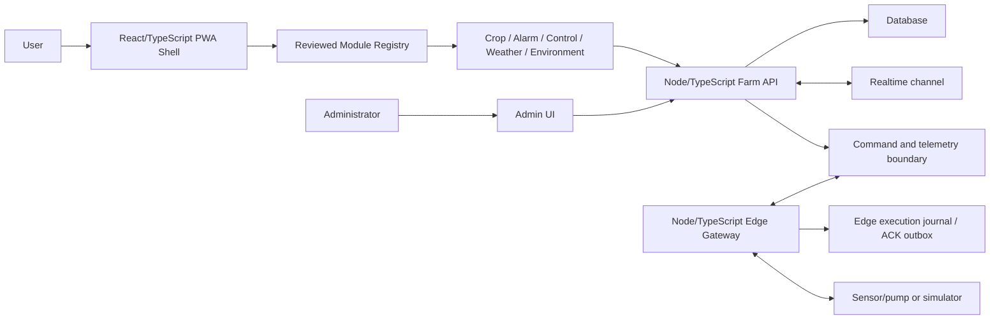

# Architecture

## Overview

SmartFarmOS uses one browser product, one farm-owned authority, and one device
boundary. A reviewed module registry composes user capabilities without making
the product a Linux distribution or permitting arbitrary runtime plugins. The
PWA never talks directly to the MQTT broker or privileged database APIs. The
Edge Gateway never owns user identity or product UI.

## Components

- `apps/pwa`: the single desktop/mobile user product. Its shared farm/device
  scope feeds separate overview, crop-operations, alarm-center, crop-journal,
  control, weather/location, and farm-environment pages so operational scope,
  alerts, records, external context, telemetry, and commands are not mixed into
  one dashboard.
  ChatGPT is excluded.
- `apps/admin`: a separate operational UI for issuing one-time gateway
  enrollment tokens, listing enrollment/credential state, and revoking device
  credentials. The local demo injects an admin identity; a deployed instance
  still requires an external administrator identity provider.
- `services/api`: authentication, farm tenancy, validation, replaceable persistence, realtime delivery, command lifecycle, and audit records.
- `services/edge`: a validated HTTP central-API client, device-execution
  boundary, and durable completed-command ACK outbox. Authenticated MQTT,
  telemetry buffering, device-state reconciliation, and multi-gateway leases
  remain later transport/ownership layers.
- `packages/contracts`: shared schemas and types for `Farm`, `Device`,
  `GrowingArea`, `CropCycle`, `Telemetry`, `AlarmRule`, `AlarmInstance`,
  `AuditEvent`, `IrrigationStrategy`, `StrategyApplication`, `Command`, and
  `CommandAck`.
- `packages/module-sdk`: runtime-validated module manifests, permissions, static registry, and canonical built-in module metadata.
- `tools/device-simulator`: deterministic telemetry and command responses for development and contest demonstrations.

## First Vertical Slice

1. A simulator emits temperature telemetry for one device in one farm.
2. The Edge Gateway validates and forwards it.
3. The central API validates farm/device scope, persists it, and emits an update.
4. The PWA displays the latest value and connection state.
5. The user requests a pump command.
6. The central API creates a uniquely identified, expiring command.
7. The Edge Gateway executes or safely rejects it and returns `CommandAck`.
8. The PWA displays `pending`, `acknowledged`, `failed`, or `timed_out`.

The next verified environment extension reuses the same path for humidity,
illuminance, and water level. Each metric is stored and cached independently,
and the simulator resumes from the maximum persisted sequence across metrics.

## Contest Slice A: Crop Operations Scope

1. The local demo seeds two bed devices and one growing area for each device.
2. One active crop cycle is assigned to both areas through a separate join.
3. Each simulator/Edge pair emits and persists an independent telemetry
   sequence, with deterministic value differences for comparison.
4. Farm-scoped operator routes list areas and list/create/update crop cycles.
5. The crop-operations PWA module selects a cycle and renders its two assigned
   areas with representative device status.

SQLite schema 3 adds only `growing_areas`, `crop_cycles`, and
`crop_cycle_areas`. It preserves the existing telemetry, command, farm, device,
and crop tables and rejects databases created by a newer unknown schema.

## Contest Slice B: Alarm and Audit Scope

1. The local demo seeds one enabled low-water rule for 2번 베드.
2. Only newly accepted matching telemetry can open, update, or clear an alarm;
   replayed or conflicting telemetry cannot change alarm state. A rule is
   evaluable only while enabled and attached to an active crop cycle.
3. One active instance is retained per farm and rule. When a rule is disabled
   or its cycle completes, the next matching accepted reading clears any stale
   active instance. Acknowledgement remains independent from that condition.
4. The farm-scoped API lists active/history alarms, acknowledges once with an
   idempotency key, and lists cycle-scoped audit events.
5. The PWA shows an alarm summary in crop operations and provides an alarm
   center with active, cleared, acknowledgement, and audit states.

SQLite schema 4 adds `alarm_rules`, `alarm_instances`, and `audit_events`.
Telemetry insertion and alarm transition share one transaction, as do alarm
acknowledgement and its audit insertion. Migrations from schemas 1, 2, and 3
preserve existing rows and unknown newer schemas remain rejected.

## Contest Slice C: Area Comparison and Control History

1. The selected crop cycle resolves its assigned growing areas in assignment
   order and uses each area's registered `primaryDeviceId` as the comparison
   source.
2. The PWA reads the existing latest and bounded history endpoints for all four
   environment metrics. It keeps the most recent 24 points per metric, labels
   current, stale, empty, error, and offline-cached states, and does not invent
   an area aggregate.
3. A farm-scoped command-list route returns at most 100 existing command
   projections, optionally filtered by a registered same-farm device. Results
   are ordered by newest projection update, then issue time and command ID.
4. Crop operations filters that history to representative devices assigned to
   the selected cycle, so an operator can identify the lower-water area and its
   most recent control result without changing scope.
5. Farm/cycle/device changes invalidate in-flight comparison reads. Transient
   failures preserve already validated values for the same scope, and the real
   browser gate verifies same-session offline preservation.

Slice C reuses SQLite schema 4, the telemetry tables, and the command table. It
adds no migration and no new device command semantics.

## Contest Slice D: Approved Irrigation Strategy Application

1. The local demo preserves the immutable V1 pump-on strategy and seeds a newer
   approved V2 strategy for the active basil cycle. V2 requests a five-second
   device-local timed run.
2. The API validates farm membership, active cycle, approved strategy version,
   assigned active areas, representative devices, pump capability, explicit
   `timed_pump` capability for V2, and unique resolved devices before creating
   any work.
3. One idempotent application creates all target commands atomically. Per-device
   command keys are derived with a bounded hash, so long client keys cannot
   collapse fan-out targets.
4. Existing Edge/simulator processing returns `CommandAck` records. For V2 the
   simulator owns the timer, returns to `off` on success or timer failure, and
   ACKs only after the final state. Each ACK
   updates its target, the application aggregates to `pending`, `succeeded`,
   `partial`, or `failed`, and terminal transitions append deterministic audit
   events without duplicating them on replay.
5. The PWA preserves an accepted pending application across transient status
   read failures, locks strategy/target changes, blocks duplicate apply, and
   resumes result reads on reconnect or manual refresh. The real browser gate
   exercises this failure path.
6. Before apply, the PWA shows each target's recent water-level or low-water
   alarm evidence. The operator must explicitly confirm the selected targets,
   timed-device duration, and physical-safety boundary; that confirmation resets on target/strategy
   changes and immediately after submit, preventing one-click wrong-target and
   repeat actions without pretending the UI owns agronomic authorization.

SQLite schema 5 adds `irrigation_strategies`, `strategy_applications`, and
`strategy_application_commands`. Application creation and ACK aggregation are
transactional. The v4→v5 migration rebuilds the old alarm-only audit table to
admit command/strategy actions while preserving prior alarm audit rows.

This slice adds simulator-backed device-local timed stop and final-off evidence.
It does not add sensor feedback, physical interlocks, durable production
firmware, or hardware proof. The preset is not a production-safe irrigation
controller.

## Pilot Reliability Extension: Durable Edge ACK Recovery

1. Before device execution, the Edge stores the normalized command in a
   separate internal repository and commits `executing` immediately before the
   adapter call.
2. The executor receives a terminal-ACK sink. The simulator calls it after
   reaching the final state and before its execution promise resolves; the sink
   commits the ACK and pending-delivery state together before the central API
   request.
3. Every poll first resends a stored ACK. The device is not called again, and
   the stored `processedAt` is preserved.
4. The ACK becomes delivered only when the central projection contains the
   exact command, ACK, and matching lifecycle result.
5. A restart record left at `executing` is not automatically retried. It returns
   `recovery_required` because the current adapter cannot prove physical state.
6. One gateway instance serializes its own polls. The design assumes one
   logical Edge owner per device; active-active delivery requires a future
   central claim/lease plus device idempotency.

The local demo selects a versioned SQLite implementation in a companion file.
This closes the completed-result/ACK-loss duplicate path. It is not a general
offline queue: telemetry, an in-progress physical timer, and device state are
not recovered by this repository. A physical adapter that actuates and crashes
before publishing its terminal result still requires its own durable command
record and state reconciliation.

## Pilot Safety Extension: Device-local Software Stop Priority

1. The existing user-created V1 pump `off` remains the stop intent; no browser
   authority field or client-selected priority is added.
2. The API exposes pending V1 `off` commands through a separate edge-only
   `next-stop` route. Each Edge device path polls it independently from the
   normal lane, so an active timed promise does not delay the stop.
3. The device executor turns the pump `off`, publishes the interrupted
   activation as ACK V2 `manual_stop` with `causedByCommandId`, and returns the
   stop command's acknowledged final-`off` ACK.
4. The Edge journal treats an acknowledged stop as a durable fence and rejects
   older V1 `on` or timed V2 activations without calling the device. The fence
   survives a local Edge restart; later commands remain eligible.
5. The central store validates the causal command across farm/device, payload,
   final-`off`, and issue-time boundaries. The Edge submits the stop ACK before
   the causal interruption ACK. Strategy-linked interruption evidence is
   copied into `command.completed` audit details.
6. The PWA keeps software stop available even when its last displayed manual
   command result is already `off`, shows the interrupted result distinctly,
   and states that this control does not replace a physical emergency stop or
   safety interlock.

This extension is simulator-backed software enforcement. It does not prove
real hardware state, hardwired override, physical interlock, active-active Edge
ownership, or certified emergency-stop behavior. See Decision 0012.

## Contest Reliability Extension: Unscoped Direct-command Audit

1. Cycle-scoped alarm and strategy events retain strict AuditEvent V1.
2. A terminal ACK for a command outside a strategy application creates one
   AuditEvent V2 with `cycleId: null` in the same central update.
3. Typed details retain direct source, device, requested action, terminal
   status/reason, resulting pump state, and a manual-stop cause when present.
4. Default audit reads exclude V2. A reviewed client opts in with
   `includeUnscoped=true`; a selected-cycle read then combines that cycle's V1
   events with farm-level direct control without inventing cycle ownership.
5. Exact ACK replay, conflicts, and strategy-mapped commands do not create an
   extra V2 event.
6. SQLite schema 6 makes only the audit `cycle_id` nullable and preserves
   existing rows through a transactional v5→v6 rebuild.

The PWA labels these records `농장 공통 제어`. This is auditability evidence,
not physical actuator state proof. See Decision 0013.

## Pilot Security Extension: Edge Device Credential Binding

1. User/admin principals remain farm-scoped. Edge principals additionally carry
   non-empty exact `(farmId, deviceId)` scopes from the trusted auth adapter.
2. Runtime validation rejects missing, malformed, duplicate, or cross-farm
   scopes and rejects device scopes on user/admin principals.
3. Telemetry, normal command pull, stop pull, and ACK require an exact pair
   before store access. A matching device ID in another allowed farm is not an
   authorization match.
4. The local demo creates a separate random internal key for each device Edge;
   the shared operator key cannot select the Edge role or a device identity.
5. The HTTP Command/ACK/Telemetry wires remain unchanged. Production adapters
   must derive these claims from authenticated credentials rather than request
   headers.

This closes same-farm sibling-device impersonation at the current API boundary.
It does not provide production identity, certificate-based authentication,
MQTT ACLs, or active-active leases. See Decision 0014.

## Pilot Security Extension: Gateway Enrollment and Revocation

1. The user PWA only links to a separately deployed administrator UI. It never
   accepts or stores enrollment codes, Edge credentials, Linux passwords, or
   SSH credentials.
2. A farm-scoped administrator issues a cryptographically random enrollment
   token bound to one stored `(farmId, deviceId)` pair. It expires after ten
   minutes, can be cancelled before exchange, and is returned only by the
   issue response.
3. The Raspberry Pi CLI reads that token from a hidden terminal prompt or
   stdin and exchanges it through an unauthenticated route whose bearer token
   is the sole enrollment authority. The exchange is atomic and single-use.
4. The API persists only domain-separated SHA-256 digests of random 256-bit
   enrollment and Edge secrets. Secret comparisons use constant-time byte
   comparison; list responses never contain a secret or digest.
5. The final Edge credential is returned once, stored on the Pi by atomic
   same-directory write with private permissions, and then used as a bearer
   credential whose server-derived principal has exactly one farm/device scope.
6. The admin can revoke an Edge credential immediately. Subsequent requests
   using it fail authentication. SQLite schema 8 adds the durable enrollment
   and credential records.
7. Linux account password changes are deliberately Pi-local. The CLI invokes
   an allowlisted system account operation without a shell and passes the
   password only through child-process stdin; neither browser nor API has a
   password-change route.

The local demo proves this lifecycle with a generated local admin identity and
simulated devices. Production administrator identity, rate limiting, hardware
installation, certificate rotation, and physical actuator evidence remain
deployment gates.

## Migration Boundary

- `../api/client` is the primary user-experience reference.
- `../MyApp` is a parity reference; required experiences migrate into the PWA before retirement is considered.
- `../api/server` is behavior reference material, not the target server structure.
- `../resberrypi/server` is the Edge Gateway behavior reference.
- `../api/admin` and `../resberrypi/client` are reviewed for genuinely administrative behavior and duplicate UI.

Legacy code is copied only with a named goal, file-level review, provenance note, secret check, and a verification plan.

The capability-by-capability retirement gate is `docs/feature-parity.md`. A
legacy screen remains preserved until the equivalent central API/Edge path and
PWA path are browser-verified; visual resemblance alone is not parity.

## Module Boundary

- `overview` is the PWA shell; the remaining navigation, routes, and overview
  cards are derived from enabled module manifests.
- Reviewed PWA web contributions render existing pages through a static registry.
- Reviewed API server contributions register existing V1 routes through the
  same module IDs. Health and farm/device catalog remain platform core.
- API modules use the injected store interface and HTTP authorization helpers;
  they do not own database or transport connections.
- Farm control now has one persisted, data-only profile for reviewed pump cards,
  labels, and start visibility. Broader Workbench configuration, journal fields,
  declarative template import, and automation rules remain M2/M3 work.

## Security Invariants

- User and administrator requests are authenticated and farm-scoped.
- Edge telemetry, command pull, stop pull, and ACK requests are authenticated to
  exact farm/device pairs; a request-selected device is never authority.
- Privileged database, service-account, MQTT, and third-party credentials are server-side only.
- Enrollment tokens and Edge credentials are one-time response material; only
  digests are persisted centrally, and browser storage is not used for them.
- Linux account passwords are changed only on the gateway and never cross the
  browser or central API boundary.
- Commands carry unique IDs, device and farm identity, issue/expiry time, requested action, and actor information.
- Edge execution journals command identity before dispatch, preserves terminal
  ACKs before upload, rejects changed replays, and does not automatically repeat
  an execution whose device result is unknown.
- Logs may contain identifiers and states, but never credentials or raw authentication material.

## Known Risks

- Legacy credentials require owner-side revocation or rotation before public release.
- Legacy source ownership and training-program reuse terms need human confirmation.
- Physical GPIO/MCU firmware has not been located; the simulator is mandatory until hardware evidence exists.
- SQLite persistence is currently limited to a single local API instance; production database scale, backup automation, and retention are not yet selected.

## Implemented Evidence

- `@smartfarm-os/module-sdk` rejects invalid manifests, unsupported platform
  versions, duplicate routes/cards, unknown configured modules, and undeclared
  implementation permissions.
- PWA navigation, deep-link allowlist, overview quick links, and domain page
  rendering are derived from the active built-in module registry while all
  existing hash routes remain stable.
- Farm-scoped control profiles persist an allowlisted set of pump cards with
  optimistic revisions. They may change labels and hide start, but cannot hide
  software stop or introduce executable code, raw commands, routes, or permissions.
- The central API registers crop operations, alarm center, crop journal,
  telemetry, command, and a normalized farm-scoped weather endpoint from the
  same reviewed manifests. Weather defaults to a deterministic fixture and can
  use a fixed-endpoint server-only live adapter; the area/cycle, alarm/audit,
  and weather routes are additive to the original HTTP V1 surface.
- `@smartfarm-os/contracts` provides strict runtime schemas and inferred TypeScript types for the V1 domain and message contracts.
- `@smartfarm-os/device-simulator` emits validated temperature, humidity, illuminance, and water-level telemetry and executes a scoped, expiring, idempotent pump command.
- The simulator producer/consumer smoke parses its JSON output back through the same contract package and verifies farm, device, command, and acknowledgement identity.
- `@smartfarm-os/api` accepts simulator telemetry, stores the latest value, creates an authenticated and expiring command, and applies the simulator acknowledgement through tested HTTP handlers.
- The API application requires an injected authenticator and does not expose an implicit allow-all server entrypoint.
- `@smartfarm-os/edge` validates telemetry, pulls only device-scoped commands,
  rejects expired or out-of-scope work before execution, converts invalid
  device responses into terminal failed acknowledgements, and persists the
  execution/ACK delivery lifecycle through an internal repository.
- Its SQLite repository preserves a completed ACK across restart, drains that
  ACK before new polling, validates exact command/idempotency identity and the
  returned projection, and leaves ambiguous in-flight work blocked for device
  reconciliation rather than re-execution.
- The Edge HTTP executor blocks redirects, bounds request duration and response size, and runtime-validates every central API response.
- A real loopback TCP smoke proves simulator → Edge → API telemetry and user → API → Edge → simulator → ACK command flow.
- `SmartFarmStore` keeps HTTP handlers independent of storage, while SQLite
  schema 8 preserves telemetry, terminal command state, farm/device/area
  catalog, crop-cycle assignments, crop records, alarms, acknowledgements, and
  irrigation strategies/applications/audit events, farm control profiles, and
  gateway enrollment/credential records across a process restart.
- The SQLite migration is create-only and transactional, rejects unknown schema versions, and has direct tests for idempotency and terminal conflicts.
- `@smartfarm-os/local-demo` composes the API SQLite store, a separate Edge
  execution/ACK SQLite journal, two independent
  Edge/simulator device paths, and two assigned growing areas on loopback with
  an explicit demo-mode guard, resumes each telemetry sequence after restart,
  generates a deterministic low-water trigger/update/clear scenario, and seeds
  compatibility V1 and default five-second timed V2 strategies for both
  eligible beds.
- The user PWA renders independently validated and cached temperature, humidity, illuminance, and water-level readings alongside pump control and terminal command status on responsive desktop/mobile layouts.
- The user PWA discovers only principal-authorized farms and their devices,
  retains the selected scope, renders active crop-cycle area assignments,
  compares four latest/history metrics across both representative devices, and
  performs persisted farm-scoped crop CRUD through strict response contracts.
- The installable PWA bundle includes a manifest, app icons, and an offline shell while excluding demo authentication material from browser assets.
- The browser gate covers the two-area crop-operations page, eight live metric
  rows and their trends/freshness, recent control history, same-session offline
  preservation, low-water alarm trigger/acknowledgement/clear/audit, discovery,
  accepted irrigation application preservation after a forced poll failure,
  explicit target/timed-device/physical-safety confirmation, final-off result,
  post-completion repeat lock,
  resumed ACK aggregation, strategy/command audit, and the opt-in farm-wide
  direct-command audit card,
  all four selected-device environment metrics, pump acknowledgement, crop
  create/reload/edit/delete, mobile overflow, per-metric offline cache
  restoration, and graceful launcher shutdown.
- MQTT/device transport, telemetry offline buffering, mid-execution device
  reconciliation, active-active Edge leases, production authentication,
  device-inventory mutation, production database scale, realtime delivery, and
  physical-device behavior remain intentionally unclaimed.
