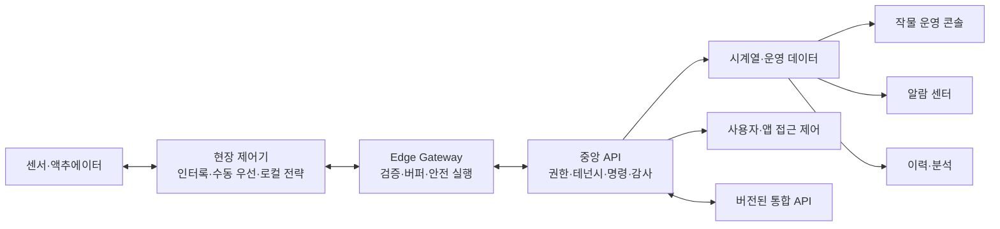
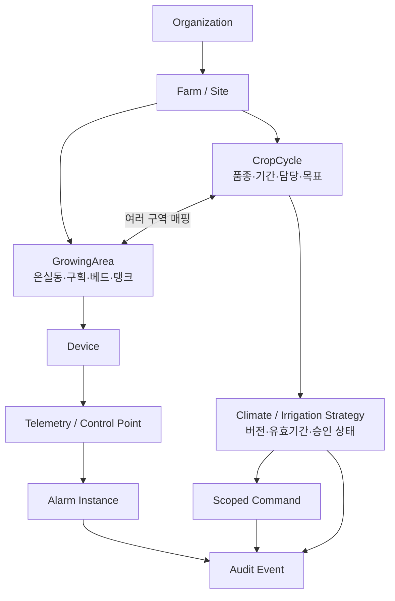

# Priva 벤치마크와 SmartFarmOS 제품 방향

- 조사 기준일: 2026-07-23
- 조사 범위: Priva 공식 웹사이트, 공식 Help Center, 공개 약관과 현재 SmartFarmOS 소스
- 목표: Priva의 공개된 제품 원리와 사업 구조를 참고하되, SmartFarmOS의 기존 경계를 최대한 재사용해 독자적인 스마트 온실 운영 제품을 만든다.
- 제외: Priva 상표·로고·문구·화면·비공개 API·독점 제어 로직의 복제, 빌딩 자동화 제품군의 구현

## 1. 결론

SmartFarmOS가 벤치마킹할 대상은 Priva 전체가 아니라 원예 제품군의 다음 조합이다.

1. **Priva One / Operator**의 작물 중심 모니터링과 제어
2. **Notification Center**의 활성·과거 알람, 확인, 개인별 알림 규칙
3. **Access Control**의 조직·사이트·사용자·애플리케이션 권한과 감사 로그
4. **Gateway + local controller**의 현장 독립 제어와 클라우드 연결 분리
5. **API Services**의 고객 소유 데이터와 통합 생태계

SmartFarmOS는 이미 `PWA -> central API -> Edge Gateway -> simulator/device`의 올바른 뼈대와 안전한 펌프 명령 생명주기를 갖고 있다. 따라서 새 제품을 다시 만들지 않고, 현재 모노레포에 **재배구역, 재배주기, 이력, 알람, 전략, 감사** 도메인을 순서대로 추가한다.

첫 제품은 “Priva 클론”이 아니라 다음처럼 정의한다.

> 중소형 온실 운영자가 작물별로 여러 재배구역의 현재 상태와 이력을 비교하고, 이상을 확인하며, 안전한 관수 전략을 현장 Edge에 적용할 수 있는 오픈소스 운영 콘솔

## 2. Priva 기업 분석

### 확인된 사실

| 항목 | 공식 공개 내용 | SmartFarmOS에 주는 의미 |
| --- | --- | --- |
| 사업 영역 | 원예, 빌딩 자동화, 실내재배의 기후 제어와 공정 자동화 | SmartFarmOS는 현재 소스와 맞는 원예만 선택한다. |
| 규모 | 560명 이상, 15개 사무소, 400개 이상 유통사, 100개 이상 국가, 원예 프로젝트 10,000건, 빌딩 40,000동 | 경쟁력은 앱 하나보다 설치 기반, 현장 전문성, 파트너 운영에서 나온다. |
| 제품 방식 | 현장 제어기·센서·수처리 장비, Gateway, Cloud, 웹 앱, API와 지원을 결합 | PWA만 비슷하게 만드는 것은 핵심을 놓친다. Edge와 운영 프로세스가 제품의 일부여야 한다. |
| 판매 방식 | 공개 정가보다 데모·문의·Order Form·인증 파트너 중심 | 초기 SmartFarmOS도 셀프서비스 결제보다 설치·온보딩 가능한 제품 패키지를 먼저 정의한다. |
| 반복 매출 | Priva One은 구독형이며 로컬 제어 모듈에서 계산한 control point 수로 월 구독 등급을 정한다. API와 24/7 지원은 추가 등급·Add-On이다. | 향후 과금 단위는 단순 사용자 수보다 `site + active control point + retention + support`가 자연스럽다. |
| 데이터 | 고객 데이터는 고객 소유로 명시하고, Cloud에 이력 저장하며 API로 공유한다. | 데이터 소유권, 내보내기, 보존기간과 애플리케이션 권한을 제품 계약에 포함해야 한다. |

회사 소개의 `100+ countries`와 메인 페이지의 `certified partners in 60 countries`는 범위가 다르다. 전자는 전체 사업·유통 범위, 후자는 현재 파트너 검색 범위로 해석하는 것이 합리적이며 같은 수치로 합치지 않는다.

### 사업 모델에 대한 근거 기반 해석

Priva의 사업 모델은 다음 다섯 층이 서로를 강화하는 구조다.

1. 현장 제어기와 센서가 장기 설치 기반을 만든다.
2. 설치·업데이트·지원은 인증 파트너와 지역 조직이 담당한다.
3. Gateway가 기존 현장을 Cloud 서비스에 연결한다.
4. 구독 앱, 이력, 알람, 분석, API와 지원 Add-On이 반복 매출을 만든다.
5. 고객 데이터와 외부 파트너 통합이 전환 비용과 제품 효용을 함께 높인다.

이 구조에서 핵심 해자는 특정 대시보드 모양이 아니다. 장기간 축적된 제어 도메인 지식, 현장 설치 기반, 안전한 Edge-Cloud 경계, 파트너 네트워크, 고객 업무에 들어간 데이터·운영 흐름의 결합이다.

### SWOT

| 구분 | 분석 |
| --- | --- |
| 강점 | 오랜 현장 제어 경험, 대규모 설치 기반, 하드웨어-Edge-Cloud 통합, 글로벌 파트너, 작물·빌딩 도메인 지식 |
| 약점 | 공개 가격이 불투명하고 도입에 Gateway·지원 버전·파트너 설치가 필요해 초기 온보딩이 무겁다. Cloud 구독 종료 시 서비스·업데이트·연결 접근도 종료된다. |
| 기회 | 다사이트 운영, 숙련 인력 부족, 물·에너지 비용 증가, 외부 AI·센서·농업 솔루션 통합 수요 |
| 위협 | 산업 제어 보안 사고, Cloud/현장 연결 장애, 상호운용성 요구, 빠른 API 변화, 외부 분석·자율재배 업체가 상위 UX를 차지할 가능성 |

약점·기회·위협은 공개된 제품 조건과 시장 메시지에서 도출한 해석이며 Priva가 직접 공시한 경영 평가가 아니다.

## 3. 벤치마킹할 제품 구조

### 원예 제품의 역할

| Priva 제품/서비스 | 사용자 가치 | SmartFarmOS 대응 |
| --- | --- | --- |
| Priva One / Operator | 여러 사이트와 작물의 기후·관수·공정을 한 작물 중심 화면에서 확인·조정 | PWA의 새 작물 운영 개요와 전략 화면 |
| Connext / Compass | 현장 기후·관수·조명·에너지 제어 | Edge 뒤의 실제 제어기 또는 시뮬레이터 |
| Priva Gateway | 현장 시스템과 Cloud의 보안 연결 | `services/edge` |
| Notification Center | 활성·과거 알람, 확인, 이메일·푸시·SMS 규칙 | 새 `alarm-center` 모듈 |
| Access Control | 사용자·앱·역할·사이트 권한, 사이트 공유, 감사 로그 | 생산 인증, 조직/사이트 RBAC, 감사 모듈 |
| API Services | 고객 데이터의 안전한 외부 통합 | 버전된 public API와 애플리케이션 자격증명 |
| FS Performance | 작업, 생산, 노동 효율과 수율 관리 | 대회 MVP 이후 작업·생산 분석 모듈 |

### 공통 아키텍처 원리



현장 제어기는 인터넷이 끊겨도 안전 상태와 필수 제어를 유지해야 한다. Cloud는 원격 가시성, 전략 배포, 이력, 협업, 알람과 통합을 맡는다. Cloud 알림만을 생명·설비 안전의 유일한 경보로 사용하지 않는다. Priva One 약관도 고객에게 별도의 primary alert system 유지를 요구한다.

## 4. 사용자 경험에서 가져올 원칙

공개된 Priva One 화면과 지원 문서에서 반복되는 흐름은 다음과 같다.

```text
작물 선택
  -> 여러 재배구역의 핵심 지표와 알람 요약
  -> 실측값과 목표 전략을 같은 차트에서 비교
  -> 편차 원인 확인
  -> 전략/설정 변경의 대상과 영향을 검토
  -> 현장 적용 결과와 감사를 확인
```

SmartFarmOS UX는 다음 원칙을 따른다.

- 첫 선택 단위를 장치가 아니라 **작물/재배주기**로 올린다.
- 작물 화면에서 연결된 여러 구역을 비교하고, 장치는 진단을 위한 하위 상세로 둔다.
- 최신 숫자뿐 아니라 **시간 변화, 목표선, 편차, 데이터 신선도**를 함께 보여준다.
- 정상 정보보다 “지금 주의가 필요한 것”을 먼저 노출한다.
- 운영자용 일상 설정과 설치자·관리자용 상세 설정을 분리한다.
- 변경 전 대상 구역, 이전값, 새 값, 적용 시각, 만료와 위험을 보여준다.
- 모든 제어 변경과 알람 확인은 actor와 결과가 남아야 한다.
- 대시보드 개인화는 코어 워크플로가 안정된 뒤 추가한다.

화면의 색상, 배치, 아이콘, 문구와 명칭은 Priva를 복제하지 않고 SmartFarmOS 디자인 시스템으로 새로 설계한다.

## 5. 현재 SmartFarmOS에서 재사용할 자산

### 그대로 확장할 정식 기반

| 자산 | 현재 역할 | 확장 방법 |
| --- | --- | --- |
| `packages/contracts` | Farm, Device, Crop, Telemetry, Command, Ack의 엄격한 런타임 계약 | GrowingArea, CropCycle, TelemetrySeries, Alarm, Strategy, AuditEvent 계약 추가 |
| `packages/module-sdk` | 검토된 정적 모듈 manifest와 권한 vocabulary | 새 운영 모듈을 같은 allowlist에 등록 |
| `services/api` | 브라우저의 유일한 데이터·제어 권한, 농장 범위 검사 | 시계열, 알람, 전략, 감사와 생산 인증 추가 |
| `services/api/src/store.ts` | 저장소 추상화 | 새 도메인의 읽기·쓰기 포트를 명시적으로 확장 |
| `services/api/src/sqlite-store.ts` | 단일 인스턴스 데모 영속성 | 스키마 migration으로 대회용 이력·알람 저장; 운영 DB는 별도 결정 |
| `services/edge` | 범위·만료·응답 검증과 실행 상태/완료 ACK를 별도 SQLite에 보존하는 안전 실행 경계 | MQTT, telemetry queue, device-state reconciliation, multi-owner lease, 로컬 전략과 actuator allowlist 추가 |
| `apps/pwa` | 설치형 데스크톱/모바일 제품 셸 | 선택 범위를 작물 중심으로 확장하고 기존 페이지를 하위 기능으로 재사용 |
| `tools/device-simulator` | 하드웨어 없는 결정적 데모 | 다구역 센서, 임계치 위반, 관수 전략 적용 시나리오 추가 |
| `tools/local-demo` | API·SQLite·Edge·Simulator 통합 실행 | 새 수직 슬라이스의 재현 가능한 증거 유지 |

### 레거시 사용 규칙

`../api`, `../MyApp`, `../resberrypi`는 기능 목록, 필드와 과거 UX의 참고 자료다. 다음 코드는 정식 제품에 직접 복사하지 않는다.

- 평문 비밀번호 비교와 불일치하는 JWT 규약
- 무인증 장치·센서·알림 라우트
- Socket.IO 이벤트를 바로 MQTT publish로 바꾸는 제어 경로
- TTL, actor, idempotency와 Ack가 없는 장치 명령
- 브라우저 `localStorage`의 장기 인증 토큰
- 하드코딩된 broker, 내부 IP, 카메라 URL과 API 키
- 요청 본문, 토큰, 외부 API URL·응답, 서비스 키를 출력하는 로그
- 브라우저 타이머가 직접 실행하는 제어 일정

레거시의 알림 CRUD, 장치 필드, LED·모터 UX는 요구사항 근거로만 사용하고 `contracts -> API -> Edge/PWA -> test` 순서로 다시 구현한다.

## 6. 도메인 모델 결정

현재 `CropRecord.deviceId`는 작물 하나를 장치 하나와 느슨하게 연결한다. Priva One식 작물 중심 운영에서는 한 작물 전략이 여러 재배구역에 적용되고, 한 구역에는 여러 센서와 액추에이터가 있으므로 이 관계를 확장하지 않는다.

목표 모델은 다음과 같다.



핵심 규칙:

- `Farm`은 장기적으로 tenant가 아니라 `Organization` 아래의 site가 된다.
- `GrowingArea`는 사용자가 이해하는 운영 구역이며 `Device`와 분리한다.
- `CropCycle`은 작물 마스터가 아니라 실제 파종·정식·재배·수확 기간이다.
- 작물과 구역의 다대다 매핑은 적용 기간을 가진다.
- `Strategy`는 수정 가능한 단일 행이 아니라 버전된 초안·승인·적용 기록이다.
- `AlarmRule`과 발생한 `AlarmInstance`를 분리한다.
- `AuditEvent`는 제어, 알람 확인, 사용자·권한 변경을 append-only로 기록한다.

## 7. 기능 격차와 우선순위

| 영역 | 현재 상태 | 목표 | 우선순위 | 주요 재사용 지점 |
| --- | --- | --- | --- | --- |
| 안전한 명령 | 펌프 on/off, TTL, idempotency, ACK, 독립 device-local software-stop lane, causal `manual_stop`, 재시작 후 stop fence가 simulator에서 구현됨 | actuator allowlist 확대, 물리 인터록·실장비 수동 우선 검증 | P0 | contracts, API command, Edge, simulator |
| 생산 인증·권한 | 인증 함수 경계, farm user scope, exact farm/device Edge scope, 장치별 local-demo key가 구현됨; production IdP/rotation은 없음 | 사용자/Edge/앱 분리, 조직·사이트·구역 역할, MFA 가능한 OIDC | 외부 배포 전 P0 | API auth/http boundary |
| 감사 | 알람·전략의 cycle-scoped V1과 수동 명령의 unscoped V2 actor·target·result가 SQLite/PWA에 구현·browser-verified; 사용자·권한 변경 감사는 미구현 | append-only actor/action/target/before/after/result | P0 | store + SQLite + API module |
| 작물 중심 범위 | 하나의 CropCycle과 두 GrowingArea 운영 범위가 구현·브라우저 검증됨 | CropCycle과 여러 GrowingArea를 한 운영 범위로 선택 | P0 | crop contracts, PWA shell |
| 텔레메트리 이력 | metric별 최신값과 최근 24개 이력, 선택 재배주기의 2개 구역·4개 지표 비교, freshness/offline 표시가 browser-verified | 기간 범위 선택, downsampling, 목표선 비교 | P0 | telemetry/store/SQLite/PWA |
| 알람 | threshold rule, active/history, severity, idempotent ack가 schema 4와 PWA에서 구현·검증됨; 알림 preference/provider는 미구현 | rule, active/history, severity, ack, 알림 preference | P0 | alarm-center module + legacy use cases |
| 재배 전략 | 호환성 pump-on V1과 기본 5초 device-local timed V2, 대상별 수위/알람 근거, 명시적 물리안전 경계 확인, 선택 구역 fan-out, final-off ACK 집계·감사, 제출 후 반복 잠금, 실행 중 software stop과 causal history가 로컬 browser-verified; 편집/diff/rollback·물리 인터록은 없음 | 기후·관수 목표와 일정의 version/diff/apply/rollback | P1 | command lifecycle, Edge |
| 다구역·멀티사이트 | 한 농장의 2개 구역·대표 장치·재배주기 배정과 일괄 비교가 browser-verified | 조직-사이트 계층, 일반화된 다장치/탱크 매핑 | P1 | catalog routes/store/PWA |
| 실시간 전달 | polling/새로고침 | reconnect 가능한 SSE/WebSocket, 이력 조회는 HTTP 유지 | P1 | API/PWA |
| MQTT·오프라인 Edge | HTTP 데모와 완료 ACK의 durable outbox/restart replay, 불명확 실행 no-replay가 구현됨; telemetry buffer·실행 중 장치복구·다중 owner는 없음 | broker 인증·topic ACL, durable telemetry queue, device reconciliation, leased ownership, local fallback | 현장 pilot 전 P0 | Edge abstraction |
| 외부 API 생태계 | 모듈 커널은 있음 | app credentials, scoped API, version/deprecation 정책 | P2 | module SDK, HTTP v1 |
| 작업·생산 분석 | 레거시에 개념만 있음 | 작업 기록, 수확량, 비용과 KPI | P2 | 새 FS-like domain |
| 사용자 대시보드 편집 | 정적 overview | 개인/공유 위젯, 템플릿과 권한 | P2 | module manifests |

`P0`라고 해도 대회용 loopback 데모와 외부 pilot의 게이트는 다르다. 생산 인증과 MQTT 보안이 끝나기 전에는 외부 네트워크에서 실장치를 제어했다고 주장하거나 배포하지 않는다.

## 8. 2026 공모전 MVP

마감 2026-08-27을 기준으로, Priva 전체 기능이 아니라 다음 한 시나리오를 완성한다.

```text
한 사용자가 작물을 선택
  -> 작물이 배치된 여러 재배구역의 실시간/과거 온도·습도·조도·수위 비교
  -> 임계치 편차 알람 확인
  -> 알람을 확인 처리하고 기록 남김
  -> 검토된 관수 전략을 선택 구역에 적용
  -> Edge가 범위·만료·중복·로컬 안전 조건을 검사
  -> 장치/시뮬레이터 Ack와 감사 로그를 PWA에서 확인
```

### 포함

- Farm -> GrowingArea -> Device 카탈로그
- CropCycle -> 여러 GrowingArea 연결
- 기간 기반 텔레메트리와 비교 차트
- 알람 rule, active/history, acknowledgement
- 관수 전략 한 종류와 버전·적용 결과
- 제어·알람 acknowledgement 감사 로그
- 다구역 simulator 시나리오
- 데스크톱·모바일·오프라인 read-only 상태

### 제외

- 빌딩 자동화
- 자율재배 AI와 수율 예측
- 사용자 편집형 대시보드 빌더
- 결제·구독 시스템
- 파트너 마켓플레이스
- 범용 플러그인 코드 실행
- 카메라 스트리밍
- 모든 레거시 외부 뉴스·지도·시세 기능의 동시 이식

날씨는 재배 의사결정과 직접 연결되는 정규화된 provider adapter가 준비될 때만 추가한다. 뉴스와 일반 지도는 Priva형 운영 콘솔의 핵심이 아니므로 우선순위를 내린다.

## 9. 실행 순서

| 기간 | 수직 슬라이스 | 완료 증거 |
| --- | --- | --- |
| 7/23–7/29 | GrowingArea/CropCycle 계약, SQLite migration, catalog API, 감사 이벤트 최소 계약 | 계약·store migration 테스트, 재시작 후 관계 보존 |
| 7/30–8/05 | 텔레메트리 기간 조회와 다구역 simulator | API range 테스트, downsampling 경계, 비교 데이터 재현 |
| 8/06–8/12 | 알람 rule -> instance -> acknowledge -> audit | 임계치 발생·해제·중복·ack와 권한 테스트 |
| 8/13–8/19 | 작물 중심 PWA와 관수 전략 적용 | 데스크톱/모바일 브라우저 E2E, 명령 Ack와 audit 표시 |
| 8/20–8/26 | 오프라인/실패 상태, 문서, provenance, 공개·보안 게이트 | `npm run verify`, 데모 리허설, BLOCK 항목 확인 |

범위가 밀리면 작업·생산 분석, 날씨, 대시보드 편집을 자르고 안전·이력·알람·감사를 유지한다.

## 10. 외부 pilot 이전 필수 게이트

- 실제 자격증명 전면 회전과 공개 검사 `BLOCK 0`
- 검토된 OIDC/OAuth2 또는 동등한 생산 인증과 안전한 세션
- 사용자·Edge·외부 애플리케이션 principal 분리
- 조직·사이트·구역 권한과 최소 권한 역할
- 모든 제어와 권한 변경의 append-only 감사
- MQTT 인증, topic ACL, TLS와 device identity
- Edge 오프라인 정책, 단일 실행 ownership, 재부팅 후 큐 정책
- 물리 인터록, 실장비 수동 우선, 비상정지, 안전 상태와 현장 시험
- 시간 동기화, freshness 알람, 백업·복구와 보존 정책
- rate limit, request size, origin, CSP와 로그 redaction
- 실장치 제어와 Cloud 알림에 대한 명확한 책임·면책·운영 절차

## 11. 상용화 벤치마크

결제 구현보다 다음 패키지 경계를 제품 문서로 먼저 검증한다.

| 패키지 | 후보 범위 |
| --- | --- |
| Community | 한 사이트, 로컬 Edge, 기본 모니터링·제어, 자체 운영 |
| Operations | 다사이트, Cloud 이력, 알람, 감사, 역할, 백업 |
| Integrations | scoped API, 애플리케이션 계정, 긴 보존기간, partner connector |
| Support | 설치 검토, 온보딩, 업무시간 지원, 별도 긴급 지원 |

Priva의 정확한 가격을 추정하지 않는다. SmartFarmOS 가격은 국내 대상 고객 인터뷰 후 사이트 수, 활성 control point, 데이터 보존기간과 지원 수준을 기준으로 검증한다.

## 12. 지식재산·출처 원칙

- 공개 페이지에서 제품 원리와 일반적 기능 아이디어만 연구한다.
- `Priva`, `Priva One`, 제품 로고를 제품명·마케팅에 사용하지 않는다.
- Priva 화면, 문구, 아이콘, 이미지와 매뉴얼을 제품 자산으로 복사하지 않는다.
- Priva의 비공개 API, 프로토콜, 파일 포맷이나 제어 로직을 추출·역설계하지 않는다.
- 호환성을 주장하려면 공개 API 약관과 상표 사용 조건을 별도로 검토한다.
- 외부 날씨·지도·시세·카메라 데이터는 공급자별 저장·캐시·재배포 약관을 확인한다.
- 기존 국비과정 소스도 작성자, 교육기관, 템플릿, 이미지와 데이터 권리를 확인하고 `기존 성과`와 `신규 개발`을 구분한다.

## 13. 공식 근거

### 기업과 제품

- https://www.priva.com/about-priva
- https://www.priva.com/about-priva/what-we-do
- https://www.priva.com/horticulture/solutions/climate-and-process-computers/priva-one
- https://www.priva.com/horticulture/solutions/digital-services/priva-connected
- https://www.priva.com/horticulture/solutions/digital-services/integrate-greenhouse-data
- https://www.priva.com/horticulture/water-management-by-priva
- https://www.priva.com/horticulture/solutions/greenhouse-sensors/priva-pim

### 운영 UX, 권한과 알람

- https://support.priva.com/hc/en-us/categories/360001309692-Connext-Operator
- https://support.priva.com/hc/en-us/articles/17732380339612-What-s-new-in-Connext-Operator
- https://www.priva.com/horticulture/solutions/digital-services/priva-connected/priva-notification-center
- https://support.priva.com/hc/en-us/articles/4402991209234-What-is-the-Notification-Center
- https://support.priva.com/hc/en-us/articles/360020943792-What-is-Priva-Access-Control
- https://support.priva.com/hc/en-us/articles/6301230347154-Audit-logs

### 계약, API와 보안

- https://www.priva.com/media/1qxnjhc3/priva-one-terms-of-service-20260325-en.pdf
- https://apiportal.priva.com/
- https://support.priva.com/hc/en-us/categories/360001125372-Priva-Cloud
- https://www.priva.com/compliance/security/cloud-security-whitepaper
- https://support.priva.com/hc/en-us/articles/360020952872-What-is-the-Priva-Edge-Gateway-Cloud-Connector-or-Gateway

공식 공개 자료만으로는 Priva의 상세 손익, 제품별 매출, 계약별 실제 가격과 비공개 제어 알고리즘을 확인할 수 없다. 이 항목은 추정값으로 채우지 않는다.
