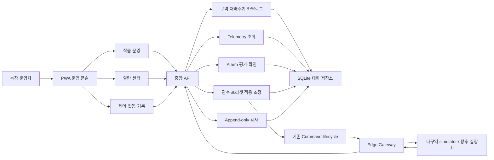
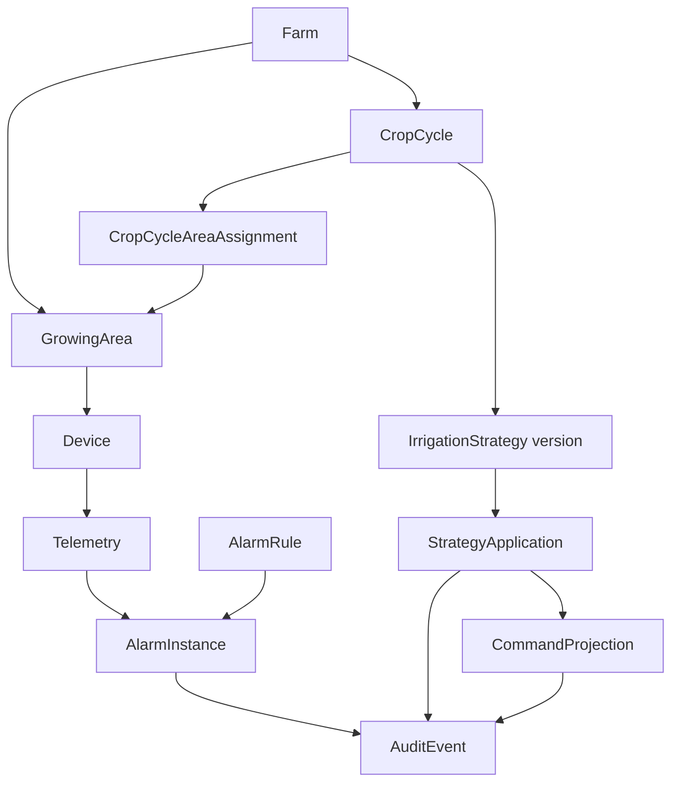
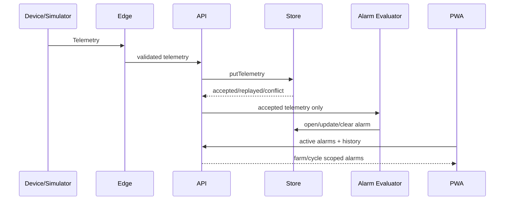

# 2026 대회 MVP 구현 청사진

- 상태: Slices A–D와 후속 Edge 안전성·수동 감사 확장 전체 검증 완료; Slice E 실참여자 검증 대기
- 기준일: 2026-08-09
- 제출 마감: 2026-08-27 18:00 (Asia/Seoul)
- 대상 사용자: 중소형 시설재배 농장의 운영자
- 전제: 대회 제출물은 로컬 API·SQLite·Edge·다구역 simulator로 검증한다.
- 비주장 범위: 생산 인증, 실제 MQTT, 물리 인터록과 실장치 제어는 파일럿 전 게이트로 남긴다.

## 1. 제품 결론

남은 기간에는 Priva의 기능 수를 따라가지 않는다. 다음 한 가지 운영 흐름을 완성한다.

> 작물의 재배주기를 선택하고, 연결된 여러 재배구역의 현재값과 이력을 비교하고,
> 이상 알람을 확인 처리한 뒤, 검토된 관수 프리셋을 적용하고,
> Edge 명령 결과와 감사 기록까지 한 화면 흐름에서 확인한다.

이 흐름은 SmartFarmOS가 이미 검증한 `PWA -> API -> Edge -> simulator -> ACK` 경로와
telemetry history를 그대로 사용한다. 새 기능은 반드시 기존 경계에 추가하며 별도 앱이나
브라우저-장치 직접 연결을 만들지 않는다.

현재 `AGENTS.md`는 생산 인증과 장치 인벤토리를 다음 parity 경계로 기록한다. 이 설계는
그 보안 요구를 약화하지 않고 **대회 구현 순서에서만** 파일럿 이후로 분리한다. 제출 demo는
loopback guarded mode로 명시하며 외부 네트워크·실장치 운영 가능성을 주장하지 않는다.

## 2. 현재 확인된 기반과 실제 격차

| 영역 | 현재 확인된 구현 | 다음 격차 |
| --- | --- | --- |
| 사용자 화면 | 농장·장치 선택, 작물 CRUD, 환경 최신값/최근 24개 추세, 펌프 제어 | 장치보다 작물/재배주기를 먼저 보는 운영 화면 |
| 중앙 API | 인증 주입 경계, farm scope, telemetry/command/crop HTTP V1 | 재배구역, 재배주기, 알람, 감사, 전략 적용 API |
| 저장소 | in-memory + SQLite schema 2, telemetry/command/catalog/crop 재시작 보존 | 새 도메인의 create-only migration과 조회 인덱스 |
| Edge | 범위·만료·계약 검증, 명령 실행, terminal ACK, 별도 SQLite 실행 journal과 완료 ACK outbox/restart replay | 파일럿 전 MQTT, telemetry buffer, 실행 중 장치복구, 다중-owner lease |
| simulator | 한 장치의 4개 환경 지표와 펌프 | 최소 2개 재배구역의 결정적 정상/이상 시나리오 |
| 검증 | 계약/API/Edge/SQLite/PWA/browser 전체 verify | 알람 발생→확인→관수 적용→ACK→감사 E2E |

## 3. 선택지와 권고

| 선택지 | 장점 | 비용·위험 | 판단 |
| --- | --- | --- | --- |
| 전체 Priva형 도메인 동시 구현 | 장기 비전이 넓다 | 18일 안에 인증·MQTT·전략엔진·다사이트까지 검증 불가 | 제외 |
| 기존 레거시 parity를 넓게 이식 | 화면 수가 빠르게 늘어난다 | 뉴스·지도·시세가 핵심 농업 운영 시나리오를 흐린다 | 대회 이후 |
| 작물 중심 한 시나리오 완성 | 기존 안전 명령과 history를 재사용하고 심사 시연이 명확하다 | 범위를 강하게 제한해야 한다 | **권고** |

## 4. 목표 아키텍처



### Part 1. 공통 계약과 식별자

- 소유: `packages/contracts`
- 역할: 모든 HTTP·저장·Edge·PWA 경계의 단일 런타임 계약
- 추가 대상: `GrowingArea`, `CropCycle`, `AlarmRule`, `AlarmInstance`,
  `AuditEvent`, `IrrigationStrategy`, `StrategyApplication`
- 원칙: 필드 추가로 기존 V1 의미를 바꾸지 않는다. 명령 의미가 바뀌면 새 계약 버전을 쓴다.

### Part 2. 농장 운영 카탈로그

- 소유: platform catalog API + `SmartFarmStore`
- 역할: `Farm -> GrowingArea -> Device`, `CropCycle <-> GrowingArea` 관계 제공
- 대회 범위: 구역은 demo seed로 제공하고, 재배주기는 목록/생성/수정과 구역 배정을 지원한다.
- 파일럿 이후: 조직, 다사이트, 장치 인벤토리 관리와 세분화된 역할을 추가한다.

### Part 3. 관측·알람·감사

- telemetry 저장은 현재 경로를 유지한다.
- accepted telemetry만 alarm evaluator에 전달한다. replay/conflict는 새 알람을 만들지 않는다.
- 알람 조건 상태와 사용자 확인 상태를 분리한다.
- 감사 이벤트는 append-only이며 제어 적용, 알람 확인, 실패 결과만 먼저 기록한다.

### Part 4. 안전한 제어와 관수 프리셋

- 전략 적용은 중앙 API가 검토된 프리셋과 대상 구역을 검증한 뒤 기존 device command로 변환한다.
- 대회 MVP는 범용 자동화 엔진이나 자율제어를 만들지 않는다.
- `StrategyApplication`이 여러 command ID와 결과를 묶어 `pending/succeeded/partial/failed`를 보여준다.
- 기존 command의 farm/device scope, TTL, idempotency, ACK 규칙은 그대로 유지한다.
- 자동 종료·센서 폐루프 관수는 새 명령 계약과 실제 Edge 안전 시험 없이는 주장하지 않는다.

### Part 5. PWA 운영 콘솔

- 전역 농장 선택은 유지한다.
- 새 `작물 운영` 페이지 안에서 재배주기를 선택한다.
- 기존 장치 선택은 환경 진단·수동 제어 화면에서 계속 사용한다.
- App shell 전체를 재작성하지 않고 새 모듈 상태는 모듈 전용 hook/service에 둔다.
- 차트는 현재 native SVG 추세 컴포넌트를 재사용하고 새 차트 의존성을 추가하지 않는다.

### Part 6. 다구역 demo와 증거

- `tools/local-demo`가 두 개의 bed device와 각 DeviceSimulator/EdgeGateway를 조합한다.
- 구역 A는 정상, 구역 B는 일정 시점에 수위 저하 또는 고온 임계치를 재현한다.
- 같은 seed와 emission index에서 같은 시나리오가 나와야 한다.
- 브라우저 smoke가 운영자의 전체 행동 흐름을 검증한다.

## 5. 도메인 모델



### 최소 엔터티 규칙

#### GrowingArea

- `id`, `farmId`, `name`, `kind`, `primaryDeviceId`, `status`, timestamps
- `kind`: `greenhouse | bed | tank`
- 대회 MVP는 한 구역의 비교용 대표 telemetry device를 명시한다.
- Device와 Area는 별도 엔터티로 유지한다. 장기적으로 한 구역의 다장치 구성을 확장한다.

#### CropCycle

- `id`, `farmId`, `name`, `cropName`, `variety`, `status`, `startedAt`, `plannedEndAt`, timestamps
- `status`: `planned | active | completed`
- 구역 배정은 별도 `CropCycleAreaAssignment`로 저장한다.
- 같은 시점에 한 구역의 active cycle은 하나만 허용한다.

#### AlarmRule / AlarmInstance

- Rule: 대상 device/area, metric, `above | below`, threshold, severity, enabled
- Instance: rule, trigger telemetry, opened/last observed value, active/cleared, ack actor/time
- 동일 rule·scope에 열린 instance는 하나만 유지한다.
- 정상 범위 복귀는 clear이고 acknowledgement는 운영자 확인이다. 둘은 같은 상태가 아니다.

#### AuditEvent

- `id`, `farmId`, actor, action, target, result, occurredAt, bounded details
- MVP action: `alarm.acknowledged`, `strategy.applied`, `command.completed`
- 수정·삭제 API를 제공하지 않는다.

#### IrrigationStrategy / StrategyApplication

- Strategy는 `id + version`으로 불변 보존하고 `draft | approved | retired` 상태를 가진다.
- MVP는 approved fixture/preset만 적용 가능하다.
- Application은 actor, cycle, area IDs, idempotency key, command IDs와 집계 결과를 보존한다.

## 6. 핵심 데이터 흐름

### 6.1 Telemetry에서 알람까지



### 6.2 알람 확인에서 감사까지

1. 사용자가 active alarm을 선택한다.
2. API가 사용자, farm, alarm scope와 idempotency key를 검증한다.
3. alarm acknowledgement와 `alarm.acknowledged` audit event를 한 transaction으로 저장한다.
4. 중복 요청은 같은 결과를 반환하고 audit를 두 번 만들지 않는다.

### 6.3 관수 프리셋 적용에서 ACK까지

1. 사용자가 approved strategy version과 대상 area를 선택한다.
2. PWA가 대상별 최근 수위·저수위 알람 근거를 보여주고, 선택 구역,
   5초 장치 로컬 종료, 물리 인터록 미검증에 대한 명시적 확인을 요구한다.
3. API가 area가 crop cycle에 배정됐고 `pump`와 `timed_pump`를 선언한
   device가 존재하는지 검증한다.
4. StrategyApplication과 대상별 command를 생성한다.
5. Edge가 각 V2 command의 scope·expiry·중복을 검사하고 simulator/device의
   로컬 타이머 실행이 끝날 때까지 기다린다.
6. 최종 `off`와 호환되는 terminal ACK만 application 결과와 audit event에 반영된다.
7. PWA는 성공, 일부 실패, 실패를 숨기지 않고 대상 구역별로 표시하며,
   제출 즉시 확인을 초기화해 우발적 반복 적용을 막는다.

## 7. 제안 HTTP 표면

기존 HTTP V1은 유지하고 아래 endpoint를 additive하게 추가한다.

| Endpoint | 역할 | 대회 범위 |
| --- | --- | --- |
| `GET /v1/farms/:farmId/areas` | 재배구역 목록 | 필수 |
| `GET /v1/farms/:farmId/crop-cycles` | 재배주기 목록 | 필수 |
| `POST /v1/farms/:farmId/crop-cycles` | 재배주기와 초기 구역 배정 | 필수 |
| `PATCH /v1/farms/:farmId/crop-cycles/:cycleId` | 상태·기간·구역 배정 변경 | 필수 |
| `GET /v1/farms/:farmId/commands?deviceId&limit` | 기존 명령 이력 | 필수, 기존 table 재사용 |
| `GET /v1/farms/:farmId/alarms?state&cycleId` | active/history 알람 | 필수 |
| `POST /v1/farms/:farmId/alarms/:alarmId/acknowledgements` | idempotent 확인 | 필수 |
| `GET /v1/farms/:farmId/audit-events?cycleId&limit` | 운영 활동 이력 | 필수 |
| `GET /v1/farms/:farmId/irrigation-strategies?cycleId` | approved 프리셋 | 필수 |
| `POST /v1/farms/:farmId/irrigation-strategies/:strategyId/applications` | 대상 구역 적용 | 조건부 필수 |
| `GET /v1/farms/:farmId/strategy-applications/:applicationId` | 적용 결과 조회 | 조건부 필수 |

Telemetry 비교는 MVP에서 area의 `primaryDeviceId`와 기존 latest/history endpoint를 재사용한다.
서버 downsampling과 다센서 area 집계 endpoint는 대회 이후에 추가한다.

## 8. 저장소와 migration 순서

한 번에 큰 schema를 만들지 않고 수직 슬라이스마다 create-only migration을 적용한다.

| Schema | 추가 | 검증 |
| --- | --- | --- |
| 2 (기존) | farm/device/crop/telemetry/command | 기존 verify 유지 |
| 3 (Slice A) | growing_areas, crop_cycles, crop_cycle_areas | 2→3 migration, 관계/재시작 보존 |
| 4 (Slice B 현재) | alarm_rules, alarm_instances, audit_events | 발생·clear·중복·ack transaction |
| 5 | irrigation_strategies, strategy_applications, application_commands | version 불변성, idempotent apply, ACK 집계 |

각 migration 전제:

- 기존 table/column을 삭제하거나 이름 변경하지 않는다.
- `PRAGMA user_version`을 한 단계씩 올린다.
- unknown newer version은 현재처럼 거부한다.
- in-memory/SQLite가 같은 store contract 테스트를 통과한다.
- 대회 DB는 재생성 가능하지만 migration 테스트는 생략하지 않는다.

## 9. PWA 정보 구조

```text
개요
작물 운영  <- 새 핵심 화면
  ├─ 재배주기 선택/상태
  ├─ 구역 A/B 최신값·신선도·추세 비교
  ├─ 활성 알람 요약
  ├─ 관수 프리셋 적용
  └─ 최근 운영 활동
알람 센터  <- active 우선, 확인과 history
농장 환경  <- 기존 장치 진단 화면 유지
농장 컨트롤 <- 기존 수동 펌프 + command history
작물일지   <- 기존 CRUD 유지
날씨·위치  <- 연동 전 상태 유지, 대회 핵심 탐색에서는 후순위
```

농업 종사자 UX 기준:

- 첫 화면에서 “어느 구역이 왜 문제인지” 10초 안에 판단할 수 있어야 한다.
- 상태는 색만으로 전달하지 않고 텍스트·아이콘·수치를 함께 사용한다.
- 알람 확인과 관수 적용 전에 대상 구역, 이전 상태, 요청 동작을 다시 보여준다.
- 최근 저수위 알람 대상이 아닌 구역을 선택하면 명시적 예외 경고와
  선택/안전 확인 없이 적용 버튼을 활성화하지 않는다.
- 성공 toast만 보여주지 않고 Edge ACK와 실패 이유를 화면에 남긴다.
- 모바일에서도 주요 행동 버튼은 44px 이상, 표는 가로 스크롤 또는 카드 대체를 제공한다.

## 10. 구현 순서와 일정

현재 날짜 기준 남은 기간은 18일이다. 아래 순서를 넘기지 않는다.

### Slice A — 8/09~8/11: 작물 운영 범위

- GrowingArea/CropCycle/assignment 계약
- SQLite schema 3와 catalog API
- local demo를 2개 device/area로 확장
- PWA 재배주기 선택과 구역 카드 골격
- 완료: 재시작 후 관계 보존, farm scope 거부, 두 구역 browser 표시

### Slice B — 8/12~8/15: 알람과 감사

- AlarmRule/Instance/AuditEvent 계약
- accepted telemetry 기반 threshold evaluator
- schema 4, active/history/ack API
- 알람 센터와 작물 운영 요약
- 완료: 발생→중복 억제→ack→clear→audit가 API/browser에서 검증됨

### Slice C — 8/16~8/19: 비교와 제어 이력

- 두 구역의 existing telemetry history 비교
- command list endpoint와 제어 이력
- 데이터 신선도, empty/loading/error/offline 표시
- 완료: 운영자가 이상 구역과 최근 제어 결과를 한 흐름에서 찾을 수 있음

### Slice D — 8/20~8/22: 관수 프리셋 적용

- approved irrigation preset과 StrategyApplication
- area→pump device→기존 command fan-out
- ACK 집계와 audit
- 완료: 성공/부분 실패/실패와 중복 적용이 검증됨

### Slice E — 8/23~8/24: 현장 사용성

- 모바일/데스크톱, 느린 응답, offline read-only, stale telemetry
- 실제 농업 종사자 또는 도메인 대리 사용자 3~5명 task test
- 익명 세션, 안전 가드레일, 도움 판정은
  `docs/usability/field-test-protocol.md`를 단일 진행 기준으로 사용
- 완료: 아래 5개 과업을 도움 없이 수행하고 관찰 이슈를 기록함

### Slice F — 8/25~8/27: 제출과 완충

- 공식 필수 산출물: 보고서, 소스코드/산출물, 3분 이내 시연영상
- 전체 `npm run verify`, 165초 데모 리허설, 장애 시나리오, 실제 영상 길이·해시 검증
- provenance/AI 사용/기존 성과 구분, license, credential/privacy release gate 확인
- 실제 3–5명 익명 결과를 비식별 JSON으로 검증·집계하고 미해결 P1/반복 P2를 차단
- 8/27은 새 기능 개발 금지, 수정과 제출만 수행

## 11. 농업 종사자 검증 과업

테스트 참가자에게 기능명을 설명하지 않고 다음 과업만 제시한다.

1. 현재 가장 주의가 필요한 구역을 찾는다.
2. 어떤 지표가 언제부터 기준을 벗어났는지 설명한다.
3. 해당 알람을 확인 처리한다.
4. 검토된 관수 프리셋을 올바른 구역에 적용한다.
5. 실제 명령 결과와 누가 언제 처리했는지 확인한다.

기록 지표:

- 과업 성공 여부와 소요시간
- 잘못 선택한 구역/버튼 수
- 도움 요청 지점
- 용어를 잘못 이해한 문장
- 작업 후 신뢰도 1~5점과 가장 불안했던 지점

## 12. 절대 컷라인

일정이 밀리면 아래 순서로 제거한다.

1. strategy 편집 UI — approved fixture 하나만 유지
2. crop cycle 고급 CRUD — seed + 최소 수정만 유지
3. audit 독립 페이지 — 작물 운영의 활동 패널만 유지
4. 비교 기간 선택 — 최근 24개 고정 유지

끝까지 유지할 것:

- farm/area/cycle scope
- telemetry history 비교
- 알람 발생·확인·clear
- 안전한 기존 command/ACK
- 감사 증거
- 다구역 simulator와 browser E2E

## 13. 대회 이후 파일럿 트랙

다음 항목은 대회 MVP와 섞지 않고 별도 게이트로 진행한다.

1. OIDC/OAuth2 기반 생산 사용자 인증, 조직/사이트/구역 RBAC
2. 장치 등록·폐기와 Edge/device identity
3. MQTT TLS, topic ACL, durable telemetry queue, 실행 중 device-state
   reconciliation, leased single execution ownership (완료 ACK outbox는 구현됨)
4. 물리 인터록, 실장비 수동 우선, 비상정지, 자동 종료와 현장 시험
5. PostgreSQL/시계열 저장소, 백업·복구, 보존·내보내기
6. realtime SSE/WebSocket, 알림 provider와 rate limit
7. 운영 로그·관측성·지원 절차와 공개 배포 보안 게이트

## 14. 안전한 구현 시작점

| 영역 | 우선 수정 지점 |
| --- | --- |
| 계약 | `packages/contracts/src/identifiers.ts`, 새 domain 파일, `http.ts`, `index.ts` |
| 권한/모듈 | `packages/module-sdk/src/index.ts`, `builtins.ts` |
| 저장소 | `services/api/src/store.ts`, `sqlite-store.ts`와 migration tests |
| API | 새 server module + `server-module-registry.ts`, `module-context.ts`, `app.ts` ID factory |
| PWA | `api/smart-farm-api.ts`, module-local state/hook, 새 operations/alarm view, web registry |
| demo | `tools/local-demo/src/runtime.ts`, `tools/device-simulator/src/simulator.ts` |
| 검증 | contracts/API/SQLite/Edge/PWA 단위 테스트와 `scripts/verify-pwa-browser.mjs` |

## 15. 현재 구현 단위

**Slice A–D는 완료되었고, Slice E 사전 리허설과 Slice F 제출
게이트도 구현되었다. 다음 실제 증거 단위는 3–5명 현장 사용성 세션과
소유자 자격증명·출처·라이선스 확인이다.** 기능 Slice의 완료 순서는
다음으로 고정한다.

```text
contracts + tests
  -> in-memory store
  -> SQLite migration + restart tests
  -> farm-scoped API
  -> two-area local demo seed
  -> PWA user surface
  -> browser smoke
  -> npm run verify
```

Slice D도 이 순서를 지켰다. 프리셋·적용 계약과 store 멱등성을 먼저
검증한 뒤 PWA 적용 화면과 실제 브라우저 장애 시나리오를 연결했다.

2026-08-09 구현 상태:

- 계약, in-memory/SQLite store, schema 3 migration, farm-scoped API 구현
- reviewed crop-operations server/PWA module과 read-first 구역 카드 구현
- local demo의 두 device/area와 하나의 active cycle seed 구현
- 계약/API/PWA/local-demo 빌드·타입 검사 통과
- `npm run verify` 통과: schema 1→3·2→3 migration/restart, farm scope,
  두 장치의 독립 telemetry, 브라우저의 재배주기 선택과 구역 카드 2개 표시
  포함
- Slice B 계약, accepted-only evaluator, schema 4 migration, farm/cycle-scoped
  alarm/audit API, 알람 센터, 작물 운영 알람 요약 구현
- `npm run verify` 재통과: 107개 테스트, schema 1→4·2→4·3→4 migration,
  trigger→duplicate update→ack replay→clear→audit 저장/재시작, 실제
  브라우저 흐름 포함
- Slice C에서 bounded command-list 계약, in-memory/SQLite 동일 정렬,
  farm/device-scoped API, PWA client와 선택 cycle 상태 연결을 구현
- 선택한 cycle의 2개 구역에서 각각 4개 latest/최근 24개 지표,
  최신도·empty/error·같은 세션 offline 보존, 최근 제어 결과를
  하나의 작물 운영 흐름에서 표시
- `npm run verify` 재통과: 112개 workspace 테스트, 모든 build/typecheck,
  simulator/API/Edge/SQLite/PWA smoke, 2구역·8지표·제어 이력·offline
  보존 브라우저 흐름 포함
- Slice D에서 versioned approved irrigation strategy, actor-scoped
  idempotent application, area→pump command fan-out, per-target ACK와
  succeeded/partial/failed aggregate, `command.completed`/`strategy.applied`
  audit을 구현
- SQLite schema 5와 실제 alarm-only schema 4 감사 테이블의 보존
  migration, 긴 idempotency key target 충돌 회귀를 API/SQLite 테스트로 검증
- local demo의 `strategy:basil-recovery`와 PWA eligible-area 선택, pending
  보존·중복 적용 차단·reconnect/manual resume를 구현하고 강제 status-poll
  실패 후 복구까지 real browser에서 검증
- Slice E 사전 리허설에서 발견한 오구역·즉시 반복 적용 위험을 대상별
  수위/알람 근거, 명시적 선택·안전 확인, 제출 후 확인 초기화로
  보완하고 데스크톱/모바일 browser gate에 추가
- Slice E 세션에서 알람이 15초 만에 사라지는 문제를 예방하기 위해
  실시간 5초 갱신을 유지하면서 저수위 회복 윈도우만 약 10분으로 분리
- 비식별 익명 세션 결과 스키마·집계기와 미해결 P1/반복 P2/안전
  위반 차단 게이트 구현
- 공식 보고서·소스·영상 요구사항, 165초 리허설, 결과보고서/AI 고지
  초안, Git·license·privacy·provenance·영상 해시/길이를 합산하는
  `npm run submission:rehearse` 구현
- `npm run verify` 재통과: 206개 workspace 테스트와 69개
  사용성/제출 스크립트 테스트, 모든 build/typecheck, schema
  1→6·2→6·3→6·실제 4→6·5→6 migration, simulator/API/Edge/SQLite/PWA
  smoke, 관수 적용 장애 복구, software stop, 농장 공통 수동 감사 브라우저,
  같은 농장 내 Edge 장치 가장 거부 흐름 포함
- 다음 실제 작업은 Slice E의 농업 종사자 또는 도메인 대리 사용자 3–5명
  task test, 결과 반영, 소유자 release BLOCK 해소, 최종 영상 녹화다
- 새 임시 DB의 검증된 PWA 장면을 Chrome/CDP로 캡처하고 ffmpeg로 무음
  후보를 만드는 `npm run submission:video-draft`를 추가했다. 실제 78초
  후보 생성까지 확인했지만 인간 개인정보·주장·나레이션 검토 게이트는
  기존 `submission:video-proof -- --reviewed`에 그대로 남겼다.
- package-lock v3의 외부 패키지 155개가 모두 선언 라이선스를 가지는지
  검증하는 `submission:license-audit`를 추가했다. 프로젝트 라이선스와
  선행 개발분 권리는 소유자/호환성 검토 전까지 BLOCK으로 유지한다.
- 후속 안전 슬라이스에서 기존 V1을 보존한 `smartfarm.command.v2`
  `run_pump_for`, 명시적 `timed_pump` capability, 5초 장치 로컬 타이머,
  최종-off ACK 검증, actor-scoped 멱등성, 장치별 독립 poll을 구현했다.
- Edge는 명령 실행 상태와 완료 ACK를 중앙 API DB와 분리된 versioned
  SQLite에 기록한다. ACK 업로드 실패/재시작은 저장된 ACK만 재전송하고,
  결과 없이 `executing`만 남은 명령은 자동 재실행하지 않는다. 이 증거는
  telemetry offline buffer, 실행 중 물리장치 복구, 다중 gateway lease를
  포함하지 않는다.
  이는 simulator-backed 증거이며 물리 인터록·실장비 펌웨어 주장이 아니다.
